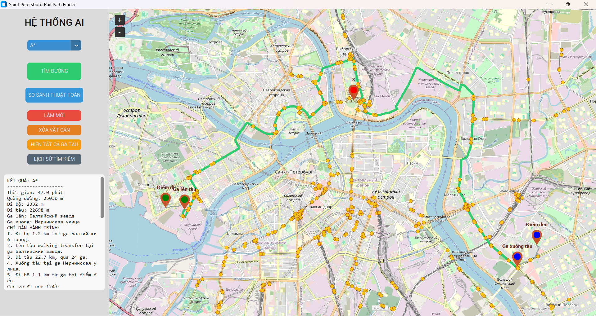

# Saint Petersburg Rail Path Finder

A Python desktop application for multimodal route finding in Saint Petersburg using OpenStreetMap data, railway/walking graphs, and classic AI pathfinding algorithms.

The app was built as an academic/personal project to explore how graph search algorithms behave on real urban transport data.

## Screenshot



## Features

- Interactive map GUI built with Tkinter, CustomTkinter, and tkintermapview.
- Route planning between two user-selected points.
- Multimodal routing using walking segments and railway/tram/rail segments.
- Supported algorithms:
  - A*
  - Dijkstra
  - Uniform Cost Search
  - Greedy Best-First Search
  - Breadth-First Search
  - Depth-First Search
  - Iterative Deepening Search
- Algorithm comparison view showing execution time, searched nodes, route type, and distance.
- Station/tram/rail stop extraction from OpenStreetMap.
- Manual obstacle placement on the map to simulate blocked rail segments.
- Step-by-step route instructions.
- Search history viewer backed by SQLite.
- Local cache/database for faster startup after the first run.
- Windows `.exe` packaging script with PyInstaller.

## Technologies Used

- Python
- Tkinter / CustomTkinter
- tkintermapview
- OSMnx
- NetworkX
- Pillow
- SQLite
- PyInstaller

## Algorithms

The project compares multiple graph search strategies on the same routing problem.

| Algorithm | Main idea | Optimal on weighted graph? |
|---|---|---|
| A* | Uses actual path cost plus a geographic heuristic | Yes, with an admissible heuristic |
| Dijkstra / UCS | Expands the lowest-cost known node first | Yes |
| Greedy Search | Expands the node closest to the goal by heuristic | Not guaranteed |
| BFS | Expands level by level | Only for unweighted graphs |
| DFS | Explores deeply before backtracking | No |
| IDS | Repeated depth-limited search | Not ideal for weighted routing |

## Project Structure

```text
|-- app.py                  # Main GUI application
|-- config.py               # App constants and map settings
|-- database.py             # SQLite persistence
|-- pathfinder.py           # Search algorithm implementations
|-- route_logic.py          # Multimodal route selection
|-- spatial_index.py        # Lightweight spatial lookup helper
|-- test_all_cases.py       # Regression/smoke tests
|-- build_exe.ps1           # Windows packaging script
|-- requirements.txt
|-- assets/
|   `-- demo.png            # README screenshot
`-- README.md
```

## How to Run

Python 3.12 on Windows is recommended.

```powershell
python -m venv .venv
.\.venv\Scripts\activate
pip install -r requirements.txt
python app.py
```

The first run may require an Internet connection to download OpenStreetMap data and map tiles. Later runs use local cache files.

## Tests

```powershell
python test_all_cases.py
```

## Build Windows EXE

```powershell
Set-ExecutionPolicy -Scope Process Bypass
.\build_exe.ps1
```

The packaged app will be generated under:

```text
dist\Saint Petersburg Rail Path Finder
```

When sharing the app, send the whole generated folder or ZIP package, not only the `.exe` file.

## My Role

In this project, I worked on:

- Loading and processing OpenStreetMap transport data.
- Building railway and walking graphs using OSMnx and NetworkX.
- Extracting and validating stations/stops.
- Implementing and comparing pathfinding algorithms.
- Designing the desktop GUI for map interaction and route visualization.
- Adding obstacle simulation, route history, and SQLite persistence.

## Data Notes

Large/generated files are intentionally excluded from GitHub:

- map cache files
- SQLite search history
- virtual environments
- build output
- packaged `.exe`/`.zip` files

These files can be regenerated locally by running or packaging the application.

## Future Improvements

- Add GTFS timetable data for more realistic train waiting times.
- Show multiple alternative routes.
- Add route preferences such as fastest route, least walking, or fewest transfers.
- Add a short demo GIF for route planning and obstacle handling.
